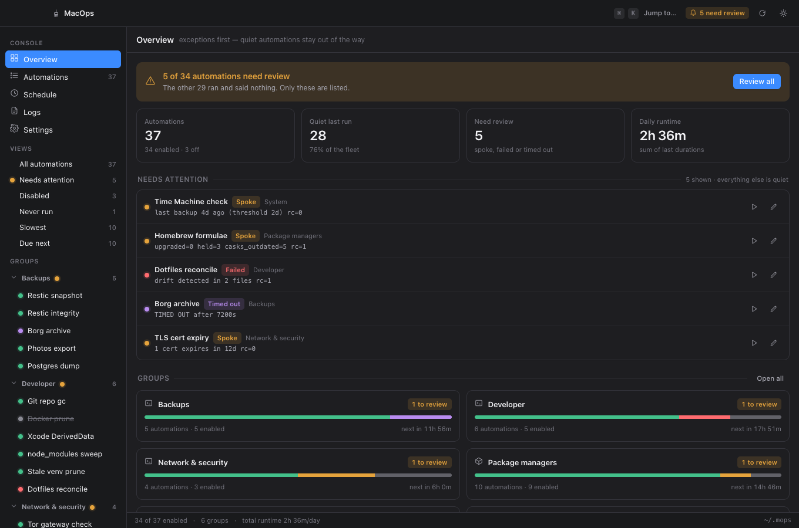
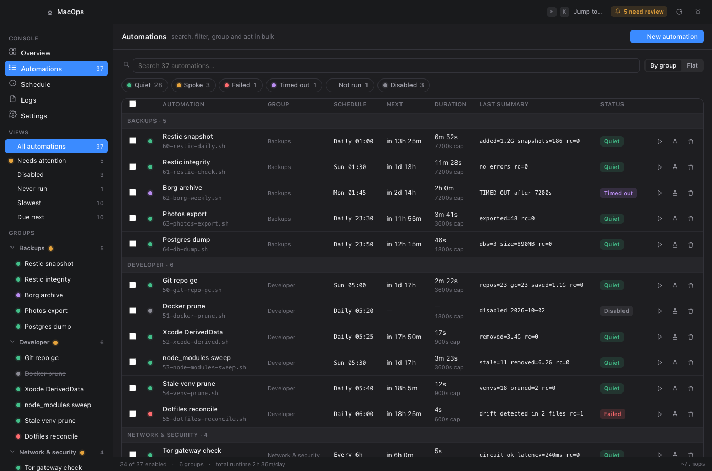
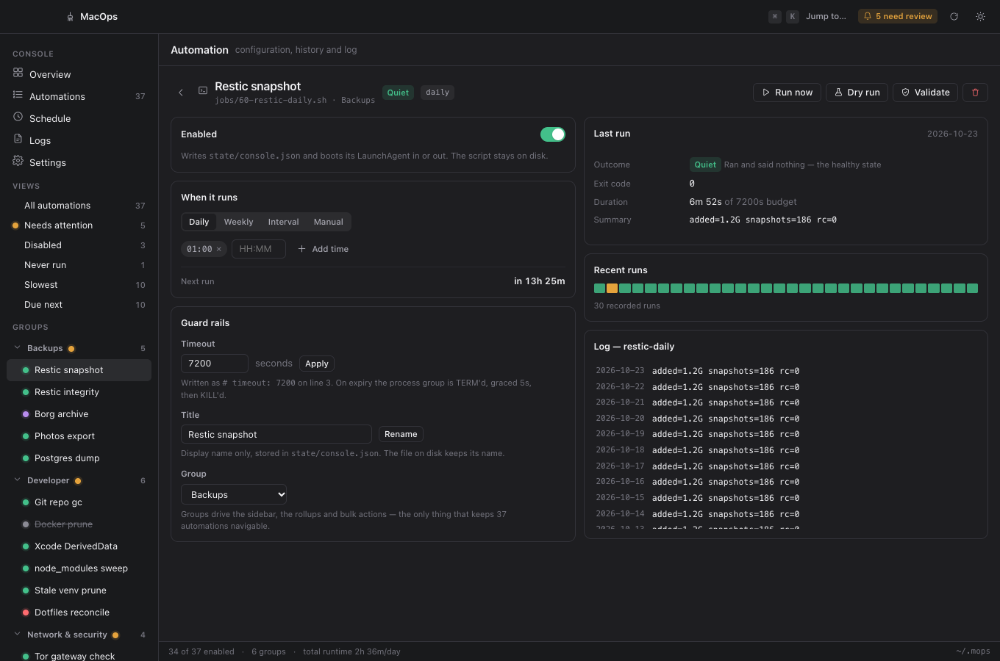
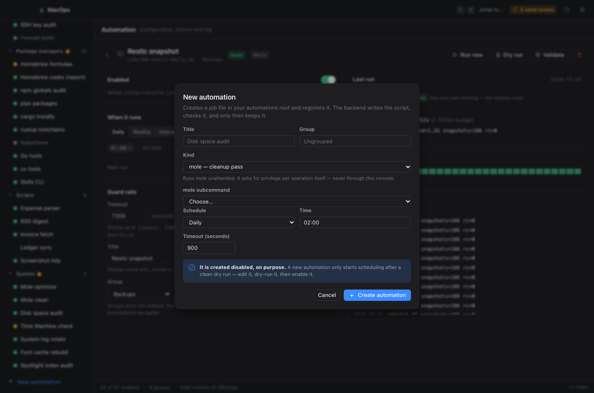
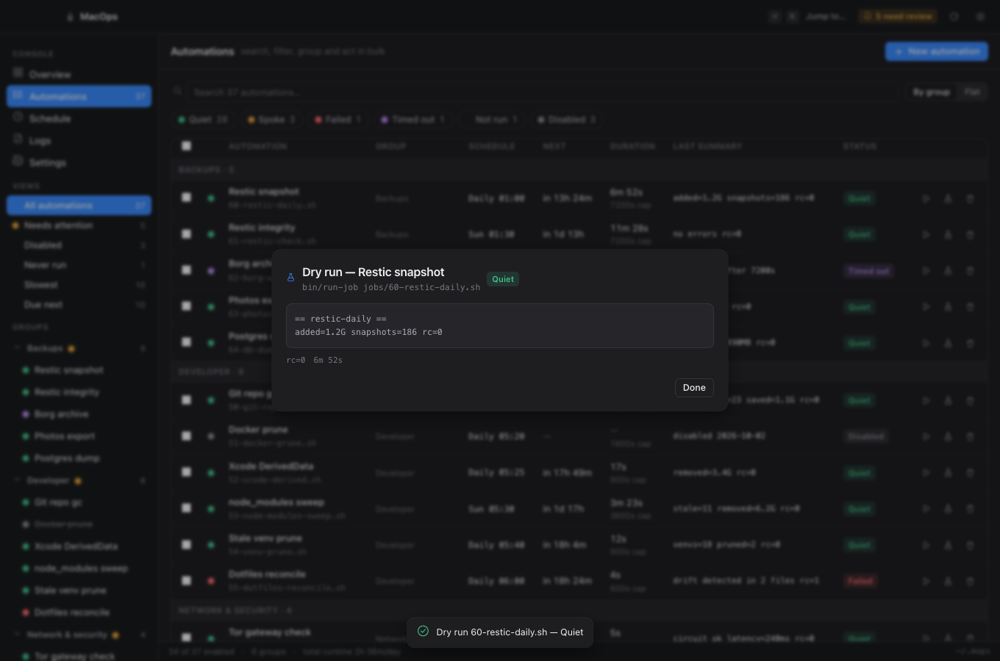
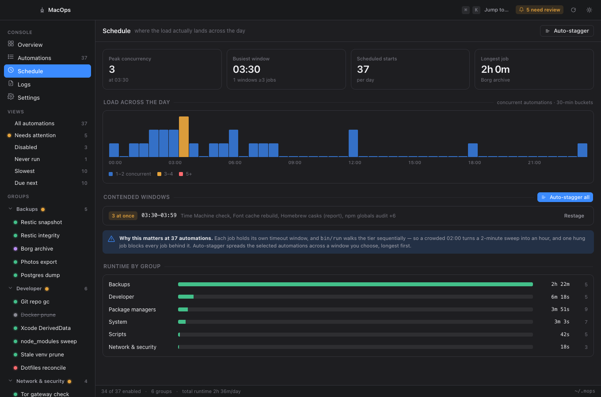
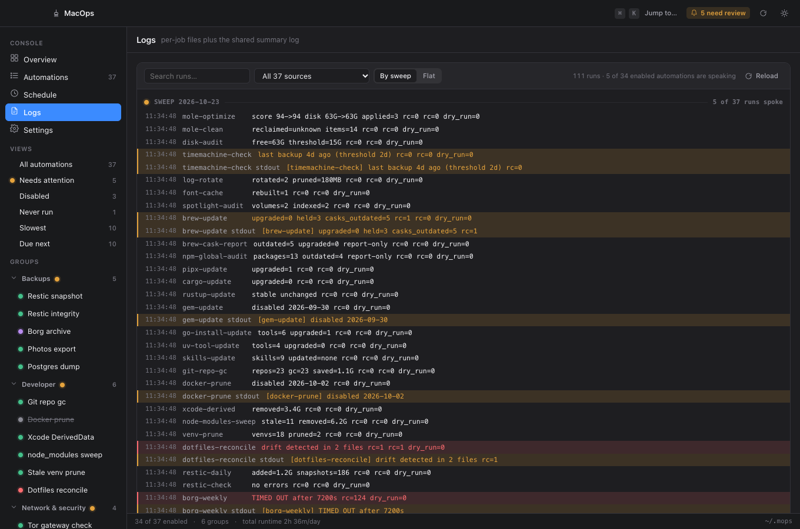
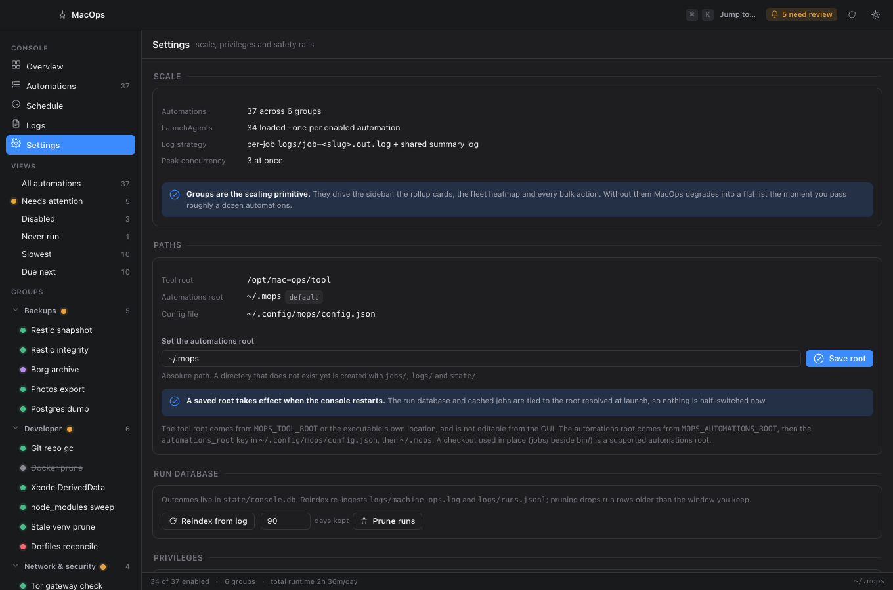

# Using the console

The console is a read-mostly window onto automations that are designed to say
nothing. Its whole layout follows from one rule in the constitution:

> **Silent on success.** A nominal run prints **NOTHING**. Jobs speak only on
> change, regression, or error.

So the console is not a dashboard of green ticks. It is an exception list. A
healthy fleet looks almost empty, and that is the point.

> The screenshots below use the built-in demo data (37 automations) so every
> state is visible at once. Your own install will look quieter.

---

## Overview — what needs you

The banner is the whole product in one line: **5 of 34 automations need review.
The other 29 ran and said nothing.** Only the five are listed.

The four tiles are deliberately boring numbers:

| Tile | Means |
|---|---|
| **Automations** | how many exist, and how many are enabled |
| **Quiet last run** | ran and said nothing — the healthy state |
| **Need review** | spoke, failed or timed out |
| **Daily runtime** | the sum of last durations, so you can see the day filling up |

**Needs attention** lists only automations whose last run was not quiet, each
with the one-line summary it logged and a badge for *why*:

- `Quiet` — ran, said nothing. Healthy.
- `Spoke` — wrote to stdout, which is the alert channel. Something changed or
  regressed.
- `Failed` — non-zero exit.
- `Timed out` — exceeded its timeout and was killed as a process group.

**Groups** are the scaling primitive. Past roughly a dozen automations a flat
list stops being navigable, so every rollup, the sidebar and all bulk actions
key off the group.

---

## Automations — the full list

Everything, searchable and filterable by status (`Quiet`, `Spoke`, `Failed`,
`Timed out`, `Not run`, `Disabled`). The checkboxes drive bulk actions: enable,
disable, run, dry-run, or move to a group.

Bulk actions are **per-file resilient** — one automation failing does not
abandon the rest, and the toast names what failed rather than reporting a
blanket success.

Each row carries a run button, a dry-run button and a delete button.

---

## Automation detail — configuration and history

Clicking any automation opens the page where you actually change things.

**Enabled** writes `state/console.json` and boots the LaunchAgent in or out.
The script itself stays on disk either way — disabling never deletes anything.

**When it runs** is `Daily`, `Weekly`, `Interval` or `Manual`, plus the times.
Changes rewrite the LaunchAgent.

**Guard rails** is the part worth understanding:

- **Timeout** is written into the script as `# timeout: 7200` on line 3. On
  expiry the whole process group is `TERM`'d, graced 5 seconds, then `KILL`'d.
  A job cannot hang forever and silence the watchdog behind it.
- **Title** and **Group** are display-only metadata in `state/console.json`.
  The file on disk keeps its name.

**Last run** shows the outcome, exit code, duration against its timeout budget,
and the one-line summary the job logged. **Recent runs** is a sparkline of the
last 30. Below it is that automation's own log.

---

## Creating an automation

**New automation** generates the job file for you — `mole`, a package manager,
a Python script, or a blank shell scaffold — writes it into your automations
root, validates the generated script, and keeps it only if it passes.

Note the blue line: **it is created disabled, on purpose.** A new automation
only starts scheduling after a clean dry run. Edit it, dry-run it, then enable
it. That order is the whole safety story for a tool that runs unattended at
02:00.

The generated file is ordinary bash you own and can edit — see
[Writing automations](writing-automations.md).

---

## Running an automation by hand

**Dry run** sets `MOPS_DRY_RUN=1` and previews without changing anything.
**Run now** applies for real. Both stream the run log live while the job works,
then show the captured output and the outcome.

The box shows the full output the job captured — the detail that the one-line
summary hides. An automation gets this by calling `log_output` (see
[writing automations](writing-automations.md#the-three-output-channels)); one
that has not opted in simply shows its summary and the honest
`(no output on stdout — silent, which is success)`.

**Always dry-run first.** A new automation is created disabled precisely so you
can edit it, dry-run it, and only then enable it.

---

## Schedule — where the load lands

`bin/run` walks a tier **sequentially**, and every job holds its own timeout
window. So a crowded 02:00 turns a two-minute sweep into an hour, and one hung
job blocks every job behind it.

The histogram shows concurrent automations in 30-minute buckets.
**Contended windows** calls out the collisions, and **Auto-stagger** spreads a
selection across a window you choose, longest job first.

**Runtime by group** shows where the day actually goes.

---

## Logs — the recorded runs

Every recorded run, newest first, grouped by sweep or flat. Severity follows
the outcome: quiet runs are unremarkable lines, `spoke` is highlighted as an
alert, `failed` and `timed out` are errors.

Each run shows its one-line summary; when it spoke, the stdout it emitted is
shown beneath. The search box queries summaries and captured output — leave it
empty to see recent history.

Two files back this view, and the distinction matters:

- `logs/machine-ops.log` — the **durable record**, append-only, shared by every
  run. It is the source of truth.
- `state/console.db` — a **derived** SQLite index, rebuildable at any time from
  the log. Losing it costs queryability, never history.

---

## Settings — roots, database, privileges

**Paths** shows the two independent roots, which is the single most important
idea to hold onto:

| Root | What lives there | Set by |
|---|---|---|
| **Tool root** | `bin/`, `lib/` — the installed tool | `MOPS_TOOL_ROOT`, else the executable's own location |
| **Automations root** | `jobs/`, `logs/`, `state/` — *your* data | `MOPS_AUTOMATIONS_ROOT`, then `~/.config/mops/config.json`, then `~/.mops` |

They are **never assumed to be the same directory**. The tool is a tool; your
automations are yours. Changing the automations root takes effect on restart —
the run database and cached jobs are tied to the root resolved at launch, so
nothing is ever left half-switched.

**Run database** offers *Reindex from log* (re-reads `logs/machine-ops.log` and
`logs/runs.jsonl`) and *Prune runs* (drops rows older than the window you keep,
always preserving each automation's newest run). Both touch only derived data.

---

## Keyboard

`⌘K` opens the command palette — jump to any automation or view by name.

---

## Next

- [Writing automations](writing-automations.md) — the job contract, in bash and Python.
